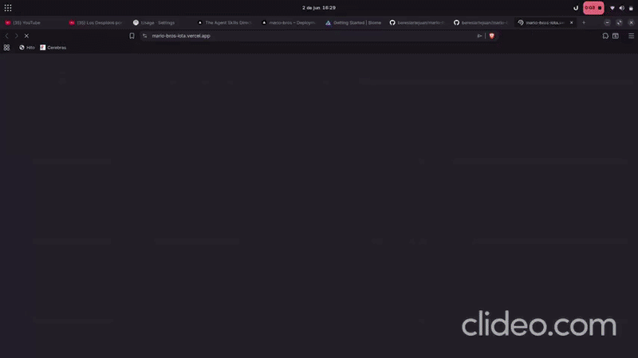

# 🔴 El Cubo Rojo - Aventura Arcade

<div align="center">

[](https://phaser.io/)
[](https://www.typescriptlang.org/)
[](https://vitejs.dev/)

**¡Una aventura arcade donde la plataforma es tu única esperanza y los enemigos son implacables!**



</div>

---

## 🎮 Sobre el Juego

**El Cubo Rojo** es un juego de plataformas arcade desarrollado con **Phaser 3** y **TypeScript**. Controlas a un intrépido cubo rojo que debe sobrevivir el mayor tiempo posible mientras recolecta monedas doradas, esquiva (¡o elimina!) enemigos geométricos y salta entre plataformas que desaparecen misteriosamente.

### ⚡ Características Principales

- 🏃 **Movimiento Fluido**: Aceleración suave, doble salto, salto variable, *coyote time* y *buffer* de salto
- 🪙 **Sistema de Monedas**: Recolecta monedas doradas; cada 25 monedas ganas una vida extra
- ⚔️ **Tres Tipos de Enemigos**: Cada uno con IA única y comportamiento diferente
- 💥 **Combos**: Encadena pisotones sin tocar el suelo para multiplicar los puntos (x2, x4, x8)
- 🎁 **Power-ups**: Invencibilidad, Super Salto y Super Velocidad, con barra de duración
- 📈 **Dificultad Progresiva**: Cada 30 segundos sube el nivel: más enemigos, más rápidos y plataformas más efímeras
- 🧱 **Plataformas Vivas**: Parpadean antes de desaparecer, las móviles te llevan encima y las grises se rompen al pisarlas
- 🔊 **Sonido Sintetizado**: Efectos generados con Web Audio, sin archivos externos
- ⏸️ **Pausa**: Manual o automática al cambiar de ventana
- 📊 **Estadísticas**: Récord, mejor tiempo, partidas jugadas y monedas totales en localStorage
- 🔄 **Generación Infinita**: Plataformas y enemigos que nunca dejan de aparecer

---

## 🕹️ Cómo Jugar

### Controles

| Tecla | Acción |
|-------|--------|
| `←` `→` / `A` `D` | Moverse izquierda/derecha |
| `↑` / `W` / `Espacio` | Saltar (¡doble salto disponible! Mantén para saltar más alto) |
| `P` / `Esc` | Pausa |
| `M` | Activar/desactivar sonido |
| `Espacio` / `Enter` | Empezar o reintentar |

### 🎯 Objetivo

- **Sobrevive** el mayor tiempo posible
- **Recolecta monedas** ($) para puntos extra y vidas
- **Elimina enemigos** saltando sobre ellos (mantén el salto para rebotar más alto)
- **No te quedes** en una plataforma que parpadea: ¡está a punto de desaparecer!
- **Aprovecha los power-ups** para ventajas temporales

### 👾 Enemigos

| Enemigo | Forma | Comportamiento |
|---------|-------|----------------|
| **Chaser** 🔷 | Rombo púrpura | Te persigue implacablemente |
| **Patrol** ⬠ | Pentágono naranja | Patrulla áreas específicas |
| **Flying** ⬡ | Hexágono cyan | Vuela hacia ti desde cualquier ángulo |

### 💎 Power-ups

| Power-up | Símbolo | Efecto | Duración |
|----------|---------|--------|----------|
| ⭐ **Invencible** | Estrella | Elimina enemigos al tocarlos | 5s |
| ↑ **Super Salto** | Triángulo rosa | Saltos más altos y potentes | 5s |
| ⚡ **Super Velocidad** | Rayo | Movimiento ultrarrápido | 5s |

---

## 🚀 Cómo Ejecutar

### Requisitos

- Node.js 18+
- pnpm (recomendado) o npm

### Instalación

```bash
# Clonar el repositorio
git clone https://github.com/beresiartejuan/mario-bros.git

# Entrar al directorio
cd mario-bros

# Instalar dependencias
pnpm install

# Iniciar servidor de desarrollo
pnpm dev
```

### Construcción para Producción

```bash
pnpm build
```

Los archivos optimizados se generarán en la carpeta `dist/`.

---

## 🏗️ Arquitectura del Proyecto

```
mario-bros/
├── src/
│   ├── main.ts              # Configuración de Phaser y arranque
│   ├── constants.ts         # Dimensiones, colores y estilos de texto
│   ├── graphics.ts          # Texturas generadas, escenario y dibujo del cubo
│   ├── sfx.ts               # Efectos de sonido sintetizados (Web Audio)
│   ├── storage.ts           # Récords y preferencias en localStorage
│   ├── style.css            # Estilos de la página
│   └── scenes/
│       ├── MenuScene.ts     # Pantalla de título
│       ├── GameScene.ts     # Lógica del juego
│       └── PauseScene.ts    # Capa de pausa
├── public/                  # Archivos estáticos (favicon)
├── index.html
├── package.json
└── tsconfig.json
```

### Sistemas Implementados

- **Object Pooling**: Reutilización de enemigos, monedas y power-ups (activando/desactivando también su cuerpo físico)
- **Sistema de Partículas**: Efectos al saltar, aterrizar, recolectar, eliminar enemigos y romper plataformas
- **IA de Enemigos**: Tres comportamientos distintos que escalan con el nivel
- **Sistema de Eventos**: Timers para spawn de objetos y power-ups (se congelan durante la pausa)
- **Persistencia**: localStorage para high scores y estadísticas

> 💡 Añade `?debug` a la URL (por ejemplo `http://localhost:5173/?debug`) para ver las cajas de colisión.

---

## 🎨 Paleta de Colores

| Color | Código | Uso |
|-------|--------|-----|
| 🟥 Rojo | `#FF0000` | Jugador |
| 🟨 Dorado | `#FFD700` | Monedas |
| 🟪 Púrpura | `#800080` | Enemigo base |
| 🟧 Naranja | `#FF4500` | Enemigo patrulla |
| 🟦 Cyan | `#00CED1` | Enemigo volador |
| 🟫 Marrón | `#8B4513` | Plataformas |
| 🟩 Verde | `#228B22` | Suelo |

---

## 📜 Licencia

Este proyecto está bajo la Licencia MIT. ¡Siéntete libre de usarlo y modificarlo!
